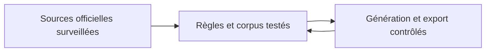

# Calibre : CV Builder avec IA

Application web de création et d'optimisation de CV, propulsée par l'IA (Claude).

## Stack technique

- **Frontend** : React 19 + Vite + Tailwind CSS v4
- **Backend** : Convex (serverless, temps réel)
- **Auth** : Clerk (Google OAuth + mode invité)
- **IA** : Anthropic Claude, unique fournisseur (claude-sonnet-4-5, claude-haiku-4-5 pour les appels rapides)
- **PDF parsing** : pdfjs-dist (client-side, zero API)
- **PDF export** : fonction serverless Puppeteer (`api/generate-pdf.ts`), impression navigateur en secours
- **Deploy** : Vercel + Convex Cloud

## Fonctionnalités

### Éditeur de CV
- Un template une colonne : Elegant
- Blocs modulables : chaque expérience a un mode (masqué/compact/normal/étendu)
- Tri automatique : fait tenir le CV dans le nombre de pages visé (1 à 3)
- Scoring de pertinence par rapport à une offre d'emploi
- Dates automatiquement raccourcies (Septembre → Sept.)
- KPI chiffrés en mode étendu
- Réordonnement des expériences
- Lien portfolio adapté à l'offre (variantes dans `VITE_PORTFOLIO_VARIANTS`)

### Import & IA
- **Import LinkedIn PDF** : parsing déterministe instantané (<100ms, 0 appel API)
  - Détection automatique du format LinkedIn via font sizes fixes
  - Extraction : nom, titre, email, téléphone, localisation, LinkedIn URL, résumé, expériences, éducation, langues, compétences
  - Gère les URLs multi-lignes, langues sans proficiency, titres longs avec virgules
  - Testé sur 4 profils différents (2-18 pages)
- **Import CV non-LinkedIn** : extraction IA structurée (fallback)
- Import offre d'emploi depuis URL (Jina Reader) ou PDF
- Optimisation du contenu par IA (reformulation, mots-clés ATS, priorisation)
- Lettre de motivation générée par IA

### Export
- Export PDF (Puppeteer) et Word (.docx), même contenu et mêmes sections visibles
- Pages A4 pré-paginées : aucun bloc coupé en bas de page

### Administration
- Fonctions IA réservées aux comptes connectés, ou aux invités munis d'un code d'accès
- Codes d'accès avec expiration et nombre d'utilisations, vérifiés côté serveur
- Panneau admin pour générer des codes et voir les demandes

## Architecture

```
src/
  lib/
    linkedin-parser.ts       ← Parser LinkedIn déterministe (zero API)
    pdf-text-extract.ts       ← Extraction texte brut PDF (pdfjs-dist)
  features/editor/
    lib/                    ← Logique pure (pas de React)
      display-modes.ts         Modes d'affichage, bullets, skills
      scoring.ts              Pertinence, score ATS
      fit-to-pages.ts           Tri automatique sur N pages
      pagination/             Construction des blocs et répartition sur les pages
      pdf-export.ts            Export PDF (endpoint serverless, impression en secours)
    templates/              ← Composants de rendu
      TemplateParts.tsx              Helpers partagés (contact, formation…)
      blockRenderers/         Rendu par bloc du template Elegant
  pages/
    EditorPage.tsx          ← Orchestration UI
    DashboardPage.tsx       ← Import, optimisation, admin
  shared/types/             ← Types TypeScript
convex/
  ai.ts                   ← Fonctions IA (Claude)
  accessCodes.ts          ← Gestion des codes d'accès
  schema.ts               ← Schéma de la base de données
```

### LinkedIn Parser : pipeline

```
PDF → pdfjs-dist tokens → tokensToLines (merge par Y-position)
  → splitColumns (X < 210 = left/sidebar, X >= 210 = right/main)
  → assignFontRoles (font-size → semantic role)
  → extractPersonalInfo / extractExperiences / extractEducation / extractLanguages / extractSkills
  → CVData (même structure que l'extraction IA)
```

Font sizes LinkedIn 2025 (stables sur tous les profils testés) :
| Font size | Rôle sémantique |
|-----------|----------------|
| ~26 | Nom complet |
| ~15.75 | Headers de section (Expérience, Formation…) |
| ~13 | Headers sidebar (Coordonnées, Langues…) |
| ~12 | Nom d'entreprise / titre court |
| ~11.5 | Intitulé de poste |
| ~11 | Liens (LinkedIn URL) |
| ~10.5 | Corps de texte |
| ~9 | Numéros de page |

## Développement

```bash
# Installation
npm install

# Développement (frontend + backend)
npx convex dev & npm run dev

# Build production
npx vite build

# Déploiement
git push origin master  # Vercel redéploie automatiquement
npx convex deploy       # Déployer les fonctions Convex en prod
```

### Variables d'environnement

**Local (.env.local)** :
```
CONVEX_DEPLOYMENT=dev:necessary-bobcat-348
VITE_CONVEX_URL=https://necessary-bobcat-348.eu-west-1.convex.cloud
VITE_CLERK_PUBLISHABLE_KEY=pk_test_...
```

**Convex (via dashboard)** :
```
ANTHROPIC_API_KEY=...       # Unique fournisseur IA
CLERK_JWT_ISSUER_DOMAIN=...
```

**Vercel** :
```
CONVEX_DEPLOY_KEY=...
VITE_CONVEX_URL=https://cautious-mule-560.eu-west-1.convex.cloud
VITE_CLERK_PUBLISHABLE_KEY=pk_test_...
```

## Règle d'or

**Le rendu/layout/pagination = logique pure, zéro IA.**
L'IA ne touche que le contenu textuel (extraction non-LinkedIn, reformulation, optimisation).
Tout le reste (modes d'affichage, auto-fit, scoring, dates, export, parsing LinkedIn) est déterministe.


## Fiabilité ATS et évolution des règles

Le pourcentage mesure la couverture des exigences extraites de l'offre, pas une probabilité d'entretien. Les conditions du formulaire sont à vérifier séparément et ne rapportent aucun point. Les niveaux CECR explicites sont comparés ; un niveau non quantifié reste inconnu. Les années spécialisées lisent les expériences du CV source, conservées à la génération, et ne comptent que celles dont le texte mentionne la discipline : cette présence ne prouve pas une utilisation continue pendant toute la période.

Choix confirmé le 2026-11-15 : les compétences absentes du CV source sont mentionnées comme objectifs de transfert vers le poste, sans maîtrise revendiquée. Elles ne sont pas attribuées à un ancien employeur ni ajoutées aux compétences détenues. Le bilan ATS distingue ces objectifs ; les anciennes générations gardent leurs ajouts historiques confirmables ou retirables. Chaque génération conserve son offre, ses exigences, le modèle demandé, les versions des règles/prompts, la durée et la couverture avant tri. Ces métadonnées restent hors des prompts et des documents exportés. Les CV plus anciens s'ouvrent sans métadonnées, avec provenance non vérifiée.

Le téléchargement PDF relit les octets produits avec pdf.js : taille réelle, couverture textuelle, champs essentiels, ordre des postes et réalisations. Un fichier refusé n'est pas téléchargé. L'impression navigateur reste disponible explicitement ; son fichier final ne peut pas être contrôlé automatiquement.

Schéma de fonctionnement, pas une capture :



### Owners et commandes de vérification

- `src/features/editor/lib/ats-rules.ts` : version active, limites et registre des sources officielles avec règle et test associés.
- `convex/_ai/prompts/` : contenu et extraction. Modifier les versions de politique correspondantes lors d'un changement effectif.
- `convex/ats.ts` : baux atomiques et cache privé par empreinte de compte/code + offre + version. Identités et texte complet de l’offre hors de cette table ; les exigences et leurs citations restent privées et expirent après 30 jours, avec purge quotidienne par lots.
- `convex/_ai/atsWatch.ts` et `convex/crons.ts` : collecte hebdomadaire des seules URL officielles enregistrées, le lundi à 07:00 UTC (08:00 Paris en hiver, 09:00 en été). Aucun appel IA et aucune donnée de candidat dans la collecte.

```powershell
npm run lint
npm run test:ats
npx playwright test e2e/ats-panel.spec.ts e2e/pdf-legibility.spec.ts
npm run build
```

### Surveillance et adoption d'une évolution ATS

Après déploiement Convex, la collecte tourne sans session locale ouverte. Le premier relevé constitue une proposition de référence à relire. Un changement ne modifie jamais les prompts : l'empreinte et le texte relus sont conservés à côté du dernier relevé. Une source inaccessible garde son dernier état et porte une erreur, jamais une fausse réussite.

Les commandes suivantes utilisent l'accès opérateur de la CLI Convex ; les fonctions de collecte et d'approbation sont internes, pas appelables par un candidat :

```powershell
npx convex run _ai/atsWatch:checkSources '{}'
npx convex run ats:sourceStatus '{}'
npx convex run ats:sourceReview '{"sourceId":"greenhouse-parsing"}'
```

Pour promouvoir une règle : lire le texte courant et la version relue (`text` / `reviewedText`), modifier l'owner existant et son cas annoté, incrémenter les versions concernées dans `ATS_POLICY`, puis passer les contrôles ci-dessus. Le build Vercel impose lint et corpus ATS avant de déployer backend et frontend de la même révision. Confirmer ensuite l'empreinte réellement lue avec la fonction interne `ats:acceptSource` (arguments `sourceId`, `hash`, `rulesVersion`) ; une empreinte qui a changé ou une version périmée est refusée.

Pour revenir à une règle précédente : restaurer la logique et les prompts concernés, conserver les champs optionnels et tables de compatibilité, attribuer une nouvelle version de politique et repasser le corpus. Ne pas effacer les CV ou réécrire leurs snapshots historiques. Une nouvelle version d'extraction invalide automatiquement les caches de navigateur et de serveur.

Le matching lexical reste explicable (libellé, variantes FR/EN, normalisation), distinct d'un moteur sémantique commercial. Avant d'ajouter un modèle ou une file de générations, mesurer les faux positifs/négatifs du corpus, les durées par génération et l'usage journalisé par appel. Aucune capacité multi-utilisateur chiffrée n'est promise sans test de charge.


### Lettre et candidature

Dans l’éditeur, **Lettre** ouvre un document modifiable, puis **CV** ramène au CV. Les deux utilisent la même offre. L’entreprise connue est réutilisée ; sinon son nom est lu dans l’offre pendant l’appel de rédaction, sans appel supplémentaire à l’ouverture. La motivation personnelle est facultative ; stade, modèle économique et ton sont dans les options repliées.

Le brouillon est associé au compte (ou au mode invité), au CV et à l’offre exacte, espaces de début et de fin ignorés. Une autre offre ouvre un autre brouillon. Le tableau de bord, dans Mes CV, liste les candidatures et permet de reprendre ensemble le CV conservé, l’offre et la lettre. Les comptes utilisent une liste paginée de métadonnées, triée par dernière sauvegarde ; les documents complets ne sont lus qu’à leur ouverture. Pour les anciennes lettres sans copie du CV, la reprise utilise la version liée si elle existe, sinon le brouillon courant après confirmation explicite.

Les écritures sont temporisées de 700 ms, avec copie locale à la fermeture et au départ de page. Le statut distingue stockage dans le navigateur et sauvegarde sur le compte, et propose une nouvelle tentative en cas d’échec. Vingt versions de texte sont conservées pour annuler une édition ou une réécriture, même après rechargement. Les brouillons historiques sans offre connue demandent une importation explicite. Aucun ancien enregistrement n’est supprimé par cette migration.

`generateCoverLetter` gère rédaction, raccourcissement et reformulation d’une sélection. Les bornes sont vérifiées avant l’accès payant ; la sélection est appliquée par le serveur, qui conserve exactement le texte extérieur. Une réponse tardive n’écrase pas une candidature modifiée. Les contrôles de sortie refusent plus de 350 mots, les nombres absents du CV et les noms détectés absents du contexte. Le raccourcissement doit retirer au moins 15 % des mots. Ces contrôles lexicaux ne constituent pas une preuve sémantique de chaque affirmation et la relecture reste nécessaire.

Les exports PDF, Word et texte sont regroupés. Le PDF téléchargé est contrôlé avec le même validateur que le CV : texte conservé, champs essentiels et ordre des paragraphes. `e2e/cover-letter.spec.ts` lit aussi le fichier réellement produit. Les actions simulées des E2E refusent localement tout appel IA non prévu.

Owners : `useCoverLetter.ts` (cycle de vie), `cover-letter-drafts.ts` (contenu et compatibilité locale, extrait du hook qui dépassait 400 lignes), `CoverLetterWorkspace.tsx` (remplace le tiroir), `convex/coverLetters.ts` (droits, recherche par empreinte SHA-256 de l’offre et pagination), `convex/_ai/coverLetter.ts` (contrôles et révisions), `export-letter.ts` (exports). Limites de persistance : 6 000 caractères par champ de lettre, 20 révisions, 500 000 caractères pour la copie du CV ; les refus sont signalés, sans effacement du texte. Les anciens contrats `coverLetters.list` et `extractCompanyMeta` restent acceptés pour les onglets déjà ouverts : le second renvoie des valeurs nulles sans IA. La nouvelle interface ne les appelle plus.

### Rédaction FR/EN et navigation commune (2026-11-15)

L’en-tête reste monté au même endroit pour le CV et la lettre : navigation, annulation, action secondaire et export occupent les mêmes emplacements, indépendamment du panneau latéral. `?document=letter` conserve le document ouvert au rechargement et dans l’historique du navigateur. Les exports se trouvent dans le même menu pour les deux documents.

La rédaction suit la langue du CV au lancement ; raccourcir ou reformuler conserve la langue de la lettre existante. Un exemple d’écriture facultatif (2 000 caractères maximum), conservé avec la candidature, guide le rythme et le vocabulaire sans devenir une source de faits. Les règles demandent une motivation réelle et une ou deux réalisations du CV, une structure adaptée au contenu et une relecture silencieuse des répétitions et formules creuses. Les formulations françaises et anglaises ont leurs propres consignes. Un seul appel au modèle rapide reste utilisé ; aucun dépôt externe n’est chargé pendant la génération.

`LETTER_WRITING_POLICY` dans `convex/_ai/prompts/coverLetter.ts` référence [blader/humanizer 4.0.0](https://github.com/blader/humanizer/tree/b48c832f0f809c1b5658edbb838c2521b72f2413), choisi pour son activité du 17 août au 15 novembre 2026 : 79 commits contre 7 pour humanizer-fr sur cette même période. Les principes éditoriaux sont adaptés, sans installer ni exécuter le skill. Pour les faire évoluer : relire une révision amont précise, modifier le prompt existant et sa version, vérifier les cas FR/EN et les gardes factuelles, puis comparer des lettres avec des lecteurs humains. Les tests automatiques vérifient les contrats, pas une préférence stylistique humaine ni une capacité à contourner un détecteur.

Attribution des principes adaptés de Humanizer, licence MIT :

> Copyright (c) 2025 Siqi Chen
>
> Permission is hereby granted, free of charge, to any person obtaining a copy of this software and associated documentation files (the "Software"), to deal in the Software without restriction, including without limitation the rights to use, copy, modify, merge, publish, distribute, sublicense, and/or sell copies of the Software, and to permit persons to whom the Software is furnished to do so, subject to the following conditions:
>
> The above copyright notice and this permission notice shall be included in all copies or substantial portions of the Software.
>
> THE SOFTWARE IS PROVIDED "AS IS", WITHOUT WARRANTY OF ANY KIND, EXPRESS OR IMPLIED, INCLUDING BUT NOT LIMITED TO THE WARRANTIES OF MERCHANTABILITY, FITNESS FOR A PARTICULAR PURPOSE AND NONINFRINGEMENT. IN NO EVENT SHALL THE AUTHORS OR COPYRIGHT HOLDERS BE LIABLE FOR ANY CLAIM, DAMAGES OR OTHER LIABILITY, WHETHER IN AN ACTION OF CONTRACT, TORT OR OTHERWISE, ARISING FROM, OUT OF OR IN CONNECTION WITH THE SOFTWARE OR THE USE OR OTHER DEALINGS IN THE SOFTWARE.

### Entreprise de l’offre et années d’expérience (2026-11-19)

L’analyse de l’offre renvoie, dans le même appel que les exigences, le nom de l’entreprise qui recrute. Le serveur le garde seulement si l’offre l’écrit mot pour mot, en cinq mots au plus (`companyNamed`). Il circule par le cache serveur, le cache navigateur et `CVData.generation.company`, puis nomme la candidature dans la carte de Mes CV, l’en-tête de l’éditeur, le champ Entreprise de la lettre et le nom des fichiers PDF et Word. Il n’entre ni dans le texte du CV ni dans un prompt. La version d’extraction `2026-11-19` invalide les analyses précédentes, qui ne portaient pas ce nom.

Les années d’expérience sont comptées depuis les dates du CV et arrondies à l’entier inférieur (`experience-years.ts`, propriétaire unique du libellé). Elles s’écrivent sous l’intitulé du profil dans l’aperçu, le PDF et le Word, et en première phrase du résumé à la génération comme aux traductions : un ATS qui filtre sur « 10 ans d’expérience » ne lit pas des dates. Jamais deux fois : un résumé qui énonce déjà des années reste intact, un résumé vide le reste. Sous deux ans, ou sans date lisible, rien n’est écrit. L’onglet ATS affiche la durée mesurée, que l’offre demande des années ou non ; `e2e/pdf-legibility.spec.ts` vérifie la mention dans les six PDF réels.

La ligne d’années se modifie dans l’aperçu comme les autres textes (`personal_info.experience_years`, champ possédé par l’utilisateur, jamais soumis au modèle). Tant qu’elle n’est pas écrite, elle suit les dates ; vidée, elle quitte le CV, le PDF et le Word, et ne laisse qu’un repère gris dans l’aperçu. Un texte écrit à la main reste tel quel dans les deux langues, comme un titre tapé à la main.

La garde de noms des lettres (`namesStated`) lit un possessif anglais comme le nom seul et une contraction comme aucun nom : « Adyen’s » nomme Adyen, « I’m » ne nomme personne, « O’Brien » reste entier. Sans cela, toute lettre en anglais était refusée.

### Preuves, langues et présentations (règles 2026-11-15.2)

Le score reste une couverture mesurée des critères de l’offre. Il apparaît dans la barre d’outils ; le bouton ouvre le bilan ATS. Un brouillon sans trace de génération est signalé et peut être adapté à nouveau depuis le CV source. Le diagnostic des qualifications non établies s’affiche déjà pendant la création, sans questionnaire supplémentaire.

La recherche d’expérience connexe utilise le même protocole pour chaque exigence : un extrait source et un extrait adapté, au même index de poste. Le serveur vérifie ces citations, puis élimine le rapprochement si la garde factuelle a retiré la puce. Une pratique réelle de gestion de projet peut soutenir une candidature demandant PMP ; elle ne vaut pas détention du certificat. Le dossier de génération conserve les citations et le bilan de complétude. Ces métadonnées sont exclues des prompts ultérieurs et des documents exportés.

Les connaissances d’une norme sont classées compétences ; les certifications détenues demandent une déclaration explicite ou un diplôme structuré, pas un nom dans une liste d’outils. Le calcul des années spécialisées conserve le périmètre de métier/secteur. Le tri préserve les dernières mentions requises, les périodes nécessaires à un minimum couvert et les expériences qui portent une preuve connexe. S’il ne peut plus réduire sans perdre ces éléments, il s’arrête et expose le nombre réel de pages.

Les langues sont reconnues avec leurs noms FR/EN et alias, même si le modèle oublie une variante. Le niveau déclaré est lu avant de demander une confirmation : CECR explicite, usage courant/professionnel et natif sont distingués, sans inventer d’équivalence avec un examen TOEIC/IELTS. Les niveaux A1 à C2 et le natif sont éditables ; le contrôle du texte PDF inclut leur rendu. La référence descriptive C1/C2 est l’[échelle officielle du Conseil de l’Europe](https://www.coe.int/en/web/common-european-framework-reference-languages/table-1-cefr-3.3-common-reference-levels-global-scale).

Dans Mise en page, Chronologie, Classique et Épuré modifient la structure visuelle en réutilisant les mêmes blocs une colonne. Les tests PDF passent sur les trois présentations en français et en anglais : mots entiers, contacts, dates avant les puces, réalisations attachées à leur employeur et niveaux de langue. Aucun contenu n’est changé par le choix de présentation.


Le 2026-11-15, l’utilisateur choisit explicitement l’objectif de transfert lorsqu’aucune pratique ne justifie une compétence. `objectiveRequirementIds` conserve cette distinction ; la garde refuse les mots concernés comme faits d’expérience ou compétences détenues, puis la finalisation écrit un paragraphe prospectif dans le profil. Le score de couverture inclut ces mots présents, sans en faire des qualifications acquises. Une ligne d’objectifs importée d’un ancien CV n’est jamais une preuve d’expertise à la génération suivante. Retirer un objectif conserve les autres. Les objectifs restent prospectifs en traduction, en PDF et en Word. Les nouvelles adaptations finalisées ouvrent Contenu, avec le bilan accessible par le score.
